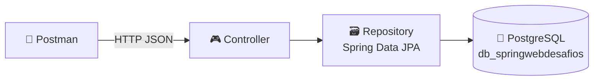

<div align="center">

# 📚✅ SpringWeb

### Duas APIs REST com CRUD completo em **Spring Boot + PostgreSQL**


📖 **Biblioteca** `/livros` &nbsp;•&nbsp; ✅ **Tarefas** `/tarefas`

*Atividade prática • FATEC Praia Grande • DSM*

</div>

---

## 📌 Sobre o projeto

Uma única aplicação Spring Boot que expõe **duas APIs independentes**, cada uma com seu próprio pacote, entidade, repository e controller, compartilhando o mesmo banco PostgreSQL.

| | 📖 Desafio 1 | ✅ Desafio 2 |
|---|---|---|
| **API** | Biblioteca | Gerenciamento de Tarefas |
| **Rota base** | `/livros` | `/tarefas` |
| **Entidade** | `Livro` | `Tarefa` |
| **Tabela** | `livros` | `tarefas` |
| **Destaque** | ISBN único | Validação de prioridade (1 a 5) |

---

## 🛠️ Tecnologias

| Tecnologia | Uso |
|---|---|
| ☕ **Java 17** | Linguagem |
| 🍃 **Spring Boot 3.4.0** | Framework |
| 🌐 **Spring Web** | API REST |
| 🗄️ **Spring Data JPA / Hibernate** | Persistência |
| 🐘 **PostgreSQL** | Banco de dados |
| 📦 **Maven** | Gerenciador de dependências |
| 📮 **Postman** | Testes dos endpoints |

---

## 🏗️ Arquitetura



### 📁 Estrutura de pastas

```
src/main/java/br/edu/fatecpg/tecprog/springweb/
├── 🚀 SpringwebApplication.java
├── 📖 biblioteca/
│   ├── model/Livro.java
│   ├── repository/LivroRepository.java
│   └── controller/LivroController.java
└── ✅ tarefa/
    ├── model/Tarefa.java
    ├── repository/TarefaRepository.java
    └── controller/TarefaController.java
```

---

## 🚀 Como executar

**Pré-requisitos:** JDK 17 • PostgreSQL rodando na porta 5432 • Maven (ou o `mvnw` incluso)

**1️⃣ Clone o repositório**
```bash
git clone https://github.com/Carlosjun1or/SpringWeb.git
cd SpringWeb
```

**2️⃣ Crie o banco de dados**
```sql
CREATE DATABASE db_springwebdesafios;
```

**3️⃣ Configure o `src/main/resources/application.properties`**
```properties
spring.application.name=springweb
server.port=8081

spring.datasource.url=jdbc:postgresql://localhost:5432/db_springwebdesafios
spring.datasource.username=postgres
spring.datasource.password=SUA_SENHA
spring.datasource.driver-class-name=org.postgresql.Driver

spring.jpa.hibernate.ddl-auto=update
```

**4️⃣ Execute**
```bash
./mvnw spring-boot:run
```
> 🪟 No Windows: `mvnw.cmd spring-boot:run`, ou rode a classe `SpringwebApplication` pela IDE.

🎉 API no ar em **`http://localhost:8081`**. As tabelas são criadas automaticamente.

> ⚠️ **"Port 8081 was already in use"?** Finalize a outra execução ou altere `server.port`.

---

## 📖 Desafio 1: API de Biblioteca

### 🧱 Entidade `Livro`

| Campo | Tipo | Regra |
|---|---|---|
| 🔑 `id` | Long | Chave primária, auto incremento |
| 📕 `titulo` | String | ❗ Não nulo |
| ✍️ `autor` | String | ❗ Não nulo |
| 🔢 `isbn` | String | ❗ Único e não nulo |
| 📅 `anoPublicacao` | Integer | Opcional |

### 🔗 Endpoints

| Método | Rota | Descrição | ✅ Sucesso | ❌ Erro |
|---|---|---|---|---|
|  | `/livros` | Cria um livro | `201` | - |
|  | `/livros` | Lista todos | `200` | - |
|  | `/livros/{id}` | Busca por id | `200` | `404` |
|  | `/livros/{id}` | Atualiza | `200` | `404` |
|  | `/livros/{id}` | Remove | `204` | `404` |

<details>
<summary>📨 <b>Ver exemplo de requisição e resposta</b></summary>

**POST** `/livros`
```json
{
  "titulo": "Clean Code",
  "autor": "Robert C. Martin",
  "isbn": "9780132350884",
  "anoPublicacao": 2008
}
```

**Resposta** `201 Created`
```json
{
  "id": 1,
  "titulo": "Clean Code",
  "autor": "Robert C. Martin",
  "isbn": "9780132350884",
  "anoPublicacao": 2008
}
```
</details>

---

## ✅ Desafio 2: API de Gerenciamento de Tarefas

### 🧱 Entidade `Tarefa`

| Campo | Tipo | Regra |
|---|---|---|
| 🔑 `id` | Long | Chave primária, auto incremento |
| 📝 `descricao` | String | ❗ Não nulo e não vazio |
| ☑️ `concluida` | Boolean | Padrão `false` |
| 🔥 `prioridade` | Integer | De **1 a 5** (opcional) |

### 🔗 Endpoints

| Método | Rota | Descrição | ✅ Sucesso | ❌ Erro |
|---|---|---|---|---|
|  | `/tarefas` | Cria uma tarefa | `201` | `400` |
|  | `/tarefas` | Lista todas | `200` | - |
|  | `/tarefas/{id}` | Busca por id | `200` | `404` |
|  | `/tarefas/{id}` | Atualiza | `200` | `400` / `404` |
|  | `/tarefas/{id}` | Remove | `204` | `404` |

### 🛡️ Validações (feitas no controller)

- 🚫 `descricao` não pode ser nula nem vazia
- 🔥 `prioridade`, quando informada, deve estar entre **1 e 5**
- ☑️ `concluida` assume `false` quando não enviada

<details>
<summary>📨 <b>Ver exemplo de requisição</b></summary>

**POST** `/tarefas`
```json
{
  "descricao": "Estudar Spring Data JPA",
  "concluida": false,
  "prioridade": 4
}
```
</details>

---

## 🧪 Testes com Postman

> Configuração: `Body` → `raw` → `JSON` com header `Content-Type: application/json`

<details>
<summary>📖 <b>Roteiro de testes: Livros</b></summary>

| # | Teste | Requisição | Esperado |
|---|---|---|---|
| 1 | ➕ Criar | POST `/livros` | `201` |
| 2 | 📋 Listar | GET `/livros` | `200` com array |
| 3 | 🔍 Buscar | GET `/livros/1` | `200` |
| 4 | ✏️ Atualizar | PUT `/livros/1` | `200` |
| 5 | 🗑️ Deletar | DELETE `/livros/1` | `204` |
| 6 | 👻 Id inexistente | GET `/livros/999` | `404` |
</details>

<details>
<summary>✅ <b>Roteiro de testes: Tarefas</b></summary>

| # | Teste | Requisição | Esperado |
|---|---|---|---|
| 1 | ➕ Criar | POST `/tarefas` | `201` |
| 2 | 📋 Listar | GET `/tarefas` | `200` com array |
| 3 | 🔍 Buscar | GET `/tarefas/1` | `200`